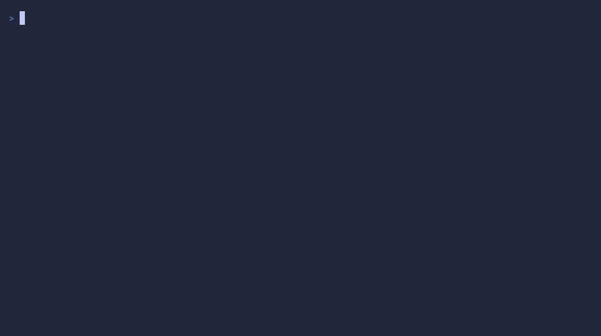

<div align="right"><sub><b>English</b> · <a href="./README.md">简体中文</a></sub></div>

<p align="center"><picture><source media="(max-width: 640px) and (prefers-color-scheme: dark)" srcset="./assets/hero-mobile-dark.svg"><source media="(max-width: 640px)" srcset="./assets/hero-mobile-light.svg"><source media="(prefers-color-scheme: dark)" srcset="./assets/hero-dark.svg"></picture></p>

<p align="center">
<a href="https://github.com/SuperMarioYL/deltagate/actions/workflows/ci.yml"></a>

<a href="./LICENSE"></a>
<a href="https://github.com/SuperMarioYL/deltagate/releases"></a>

</p>

<p align="center"></p>

<p align="center"><b>After a quant swap, decide record by record which extracted documents may ship.</b><br>
<sub>The last human-approved output is the reference · per-field delta limits per output type · exit code 3 means review</sub></p>

<p align="center"><a href="#why-deltagate">Why</a> · <a href="#architecture">Architecture</a> · <a href="#install">Install</a> · <a href="#quickstart">Quickstart</a> · <a href="#usage">Usage</a> · <a href="#demo">Demo</a> · <a href="#capabilities-and-boundaries">Boundaries</a> · <a href="#pricing">Pricing</a> · <a href="#roadmap">Roadmap</a></p>

## Why DeltaGate

GGUF quant packages change weekly, and privately hosted Qwen or DeepSeek deployments quietly swap their serving stack too. Same extraction prompt, same invoice, re-run — and the field values differ: eight jiao on the total, a date one day later, or a two-line item that now has three lines.

There are three usual answers to "may this batch ship", and none of them is enough:

- **Byte or fuzzy diff**: it flags "service fee" becoming "technical service fee" and a ¥10 shortfall in the amount with the same weight. One is harmless, one needs a human — but a diff gives you no rule for which is which.
- **Aggregate evals**: they tell you the sample score moved, not which four records to re-read. Production data has no labels, so the score often cannot be computed at all.
- **Re-reading the batch by hand**: the most reliable option, and the least realistic. The changed records end up shipping unread.

What is missing is a **per-record** release criterion. DeltaGate supplies one: it takes the last **human-approved** output as the reference value — these records have no ground truth, so that is the only reference available — and applies a per-field delta limit for each `output_type`, deciding `RELEASE` or `REVIEW` for every record. The decision unit is always the record: any breached field, or a structural change such as an array resize or an added field, sends the whole record to a reviewer; otherwise it ships. There is no batch-level score path.

Limits are not guesses. `calibrate` takes a quantile of the deltas observed across accepted history, driven by a **false-flag budget**: a 5% budget places the limit near the 95th percentile, meaning roughly 5% of a stable batch is expected to be flagged. The newest pair of snapshots is held out to measure the actual flag rate, and the report publishes that number. It measures change, not correctness.

None of this depends on the inference stack. DeltaGate does not plug into a local agent stack such as ASI and does not assume a model vendor; a GGUF swap is just the most common trigger. Input is already-structured JSON; output is a per-record decision list and an archivable release record.

## How a record is decided

One `check` does three things: load two snapshots, compare every field under the rules, write four artifacts.

<p align="center"><picture><source media="(max-width: 640px) and (prefers-color-scheme: dark)" srcset="./assets/process-mobile-dark.svg"><source media="(max-width: 640px)" srcset="./assets/process-mobile-light.svg"><source media="(prefers-color-scheme: dark)" srcset="./assets/process-dark.svg"></picture></p>

| Field kind | Comparison | Default limit |
|---|---|---|
| `money` | `abs(Δ) > max(floor, limit × abs(before))` | 0.5%, floor ¥0.01 |
| `numeric` | same as money | 1% |
| `date` | whole days | 0 days (any date change breaches) |
| `code` | exact after normalization | any change breaches |
| `text` | `1 - fuzz.ratio(a, b) / 100` | edit ratio 0.2 |

Arrays are compared by index; a length change is itself a structural change and goes straight to REVIEW, as does an added or removed field. Text distance is deterministic and makes no semantic-equivalence judgement — a paraphrase is still a change, just possibly below the limit.

## Architecture

One Python package, four commands, no daemon, zero network calls. `store.py` is the only module that knows the directory layout, and `rules.py` is the only authority for limits; `delta.py` defines the comparison semantics that `calibrate.py`, `gate.py` and `report.py` consume.

<p align="center"><picture><source media="(max-width: 640px) and (prefers-color-scheme: dark)" srcset="./assets/architecture-mobile-dark.svg"><source media="(max-width: 640px)" srcset="./assets/architecture-mobile-light.svg"><source media="(prefers-color-scheme: dark)" srcset="./assets/architecture-dark.svg"></picture></p>

| Module | Responsibility |
|---|---|
| `cli.py` | The four commands and the exit codes |
| `store.py` | Snapshot directory layout, record loading, writing the four artifacts |
| `rules.py` | The YAML rules file; `limits_version` is `v` plus the first 12 hex characters of its SHA-256 |
| `delta.py` | Normalization, kind inference, per-field deltas, breaches, structural changes |
| `calibrate.py` | Quantile limits from history, flag rate on the held-out pair |
| `gate.py` | Record verdicts, the manifest, review CSV validation and idempotent `accept` |
| `report.py` | Single-file HTML (inline CSS, no external JS) and the review CSV |

`limits_version` is content-derived, so editing any limit changes it. Each breach in the report shows the numeric limit actually applied to that field alongside `limits_version`; the manifest carries `limits_version` and the calibration provenance rather than a copy of the limit table, and `accept` refuses a review written against a different one.

## Install

Requires **Python 3.12+**. No daemon, no account, no network at runtime.

```bash
git clone https://github.com/SuperMarioYL/deltagate.git
cd deltagate
uv venv
uv pip install -e .
source .venv/bin/activate
```

Or install it straight from the repository as a standalone command:

```bash
pipx install git+https://github.com/SuperMarioYL/deltagate
# or
uv tool install git+https://github.com/SuperMarioYL/deltagate
```

Releases carry a wheel, an sdist and `checksums.txt`; once the first release is out you can download and install locally from [Releases](https://github.com/SuperMarioYL/deltagate/releases).

## Quickstart

The repository ships a synthetic 24-invoice fixture: `examples/invoices/accepted/` is the last approved output, `examples/invoices/rerun/` is the post-swap re-run, `examples/invoices/history/` holds three historical snapshots, and `examples/invoices/rules.yaml` is already calibrated to a 5% budget.

```bash
deltagate check \
  --baseline examples/invoices/accepted \
  --candidate examples/invoices/rerun \
  --rules examples/invoices/rules.yaml
```

Expected output (exit code 3):

```text
DeltaGate · limits v0f168164212b · budget 5.0% · source calibrated (holdout 3.1%)
24 records  →  20 RELEASE   4 REVIEW   flag_rate 16.7% vs budget 5.0%
exit 3  (review required)
  INV-1007  invoice    total_amount   ¥1,284.00 → ¥1,294.20  Δ +0.79%  limit 0.50%  BREACH
  INV-1009  invoice    line_items     length 3 → 2                                STRUCTURAL
  INV-1013  invoice    line_items[1].amount  ¥88.00 → ¥96.80  Δ +10.0%  limit 0.50%  BREACH
  INV-1021  invoice    line_items     length 4 → 3                                STRUCTURAL
out/decisions.jsonl   out/report.html   out/manifest.json
```

20 of the 24 ship — three of them are benign rewrites of `remark`, `seller` and a line description with edit ratios between 4.8% and 16.7%, all under their limits. The four in the queue are two money breaches and two array-length changes.

Only the REVIEW records need a human:

```bash
cat out/review.csv
# record_id,output_type,decision,limits_version,reason
# INV-1007,invoice,,v0f168164212b,
# INV-1009,invoice,,v0f168164212b,
# INV-1013,invoice,,v0f168164212b,
# INV-1021,invoice,,v0f168164212b,
```

Fill `decision` with `release` or `reject`; a reject must carry a reason. Then:

```bash
deltagate accept --manifest out/manifest.json --review out/review.csv \
  --into accepted/ --rules examples/invoices/rules.yaml
# accepted 24 record(s) into accepted/rerun-… · limits v0f168164212b · manifest <12-hex>
```

The new snapshot is archived together with its manifest, and the next `calibrate` gains another history point. Accepting the same batch, or the same review file, twice is refused.

From `git clone` to the first `check` is typically two or three minutes with the commands above; the ten-minute budget is for finding your own data and editing three to five limits.

## Usage

| Command | What it does | Main options |
|---|---|---|
| `deltagate init` | Scan output types and field paths, write conservative defaults | `--accepted DIR` `--out rules.yaml` `[--budget]` |
| `deltagate calibrate` | Fit limits from history and record the holdout flag rate | `--history DIR` `--rules FILE` `[--budget]` |
| `deltagate check` | Compare every record and write the four artifacts | `--baseline DIR` `--candidate DIR` `--rules FILE` `[--out DIR]` |
| `deltagate accept` | Consume a review, archive the new snapshot and manifest | `--manifest FILE` `--review FILE` `--into DIR` `[--rules FILE]` |

**Exit codes**

| Code | Meaning |
|---|---|
| `0` | Everything released |
| `2` | Usage, rules-file or state error (repeated accept, version mismatch, incomplete review) |
| `3` | At least one record needs review |
| `4` | More than 2% of the candidate records are malformed; fix the input first |

**Artifacts**

| File | Contents |
|---|---|
| `out/decisions.jsonl` | One line per candidate record with its full verdict (before/after, delta, limit, breach) |
| `out/report.html` | Single-file report: batch chip, breached-field table, per-record decisions, limit provenance |
| `out/manifest.json` | `batch_id`, `limits_version`, `budget`, counts, `flag_rate`, `verdicts_sha256`, calibration source |
| `out/review.csv` | REVIEW records only, with `decision` and `reason` left for the reviewer |

`check` reads candidate records from the directory, one JSON file per record, and decides them in `record_id` order. Malformed records are counted and skipped; above 2% the run exits 4.

## Demo

<p align="center"></p>

A 45-second recording; every command and line of output is taken verbatim from this repository's fixture. Three things to notice:

1. The batch verdict comes first: `24 records → 20 RELEASE 4 REVIEW`, `flag_rate 16.7%` against `budget 5.0%`, `exit 3`.
2. Breaches expand down to the field row: `INV-1007 total_amount ¥1,284.00 → ¥1,294.20 Δ +0.79%`, with `limit 0.50%` beside it.
3. `out/` holds the four artifacts from that run; the manifest's `calibration` block states `source: calibrated`, `history_snapshots: 3`, `holdout_flag_rate: 0.03125`.

The report is a single HTML file with inline CSS and no external JS, so it opens and archives on an offline machine. The fixture is entirely synthetic and contains no real company or tax information.

## Capabilities and boundaries

<p align="center"><picture><source media="(max-width: 640px) and (prefers-color-scheme: dark)" srcset="./assets/capabilities-mobile-dark.svg"><source media="(max-width: 640px)" srcset="./assets/capabilities-mobile-light.svg"><source media="(prefers-color-scheme: dark)" srcset="./assets/capabilities-dark.svg"></picture></p>

| The question you have | What DeltaGate gives | What it does not |
|---|---|---|
| May this batch ship after the swap? | `RELEASE` or `REVIEW` per record, with the exact breached fields | Whether an output is "correct" |
| Release evidence | A manifest with the limit version, verdict hash and calibration provenance | Electronic signatures or tamper-proof storage |
| Review only what matters | A `review.csv` containing only REVIEW records | Upstream re-run scheduling or automatic rollback |
| Coexist with batch evals | A per-record criterion | A replacement for aggregate scores or significance tests |

Concretely:

- **It measures change, not correctness.** A breached record may be a harmless rewrite; an under-limit record may still be wrong. The holdout flag rate exposes the latter instead of the report hiding it.
- **It needs a stored, approved structured output.** If the last batch survives only as signed PDFs, there is no reference value and this tool cannot help.
- **Structured JSON only.** No extraction, no model calls, no OCR, and no direct PDF, image or Excel input.
- **Text uses deterministic edit distance**, not an LLM-as-judge semantic equivalence call.
- **Arrays are compared by index**, so a reorder shows up as several changed fields; nesting deeper than two levels and rule inheritance across `output_type` are out of scope for v0.1.
- **No scheduling or monitoring.** No periodic re-runs, drift alerts or automatic rollback, and no database or object-store connectors.
- **No labelling tool and no significance testing**; the output is JSONL, a single HTML file and a review CSV — no Excel report.

## Configuration

The rules file is the single source of limits. `init` writes one entry per field found in the snapshot, with array elements keyed by a template such as `line_items[].amount`:

```yaml
limits:
  invoice:
    invoiceNum:
      kind: code
      unit: exact
      limit: 0.0
      normalize: [nfkc, strip_ws, cf_upper]
    total_amount:
      kind: money
      unit: relative
      limit: 0.005
      floor: 0.01
    remark:
      kind: text
      unit: edit_ratio
      limit: 0.2
      normalize: [nfkc, strip_ws]
calibration:
  source: calibrated
  budget: 0.05
  quantile: 0.95
  holdout_flag_rate: 0.03125
```

- `kind` chooses the comparison; `unit` must be one that kind allows. `money` and `numeric` accept `relative` or `absolute`, `date` uses `days`, `code` uses `exact`, `text` uses `edit_ratio`.
- `limit` is the main threshold and `floor` is an absolute lower bound: a ¥0.01 floor on money fields stops a one-cent move from being reported as a relative breach.
- `normalize` runs before comparison: `nfkc` (width and compatibility forms), `strip_ws` (collapse whitespace), `cf_upper` (case fold).
- `calibration` records where the limits came from: `source` is `defaults` or `calibrated`, `budget` is the false-flag budget, and `holdout_flag_rate` is what that budget actually flagged on held-out data. Editing `limit` by hand does not update these fields — re-run `calibrate`, or set `source` back to `defaults` and say why.
- Any edit changes `limits_version`, which is why an old review file cannot be used to release a batch measured against new limits.

`calibrate` rules: at least three snapshots are needed to fit on the earlier pairs and still hold one out; a field needs at least five observations before it is fitted; `code` fields are never fitted; a zero quantile is not adopted, so the declared limit stays. Raising the budget from 5% to 30% tightens the limits and raises the holdout flag rate — a test pins the case that a threefold tighter limit materially raises that rate.

## Pricing

The CLI and self-hosting are a complete MIT-licensed implementation, with no feature gate, no account and no network. What customers pay for is finishing the job **inside an intranet**, not the commands:

- **Offline package**: zero-egress delivery for air-gapped environments.
- **A maintained rule library per output type**: field kinds, units and limits for `invoice`, `ticket` and official-document outputs, kept current as models and business rules change.
- **Audit archive export**: manifests, `limits_version` values and review records arranged into retainable release evidence.

Paid delivery opens after the first validation teams have run their own batches; until then we only run trials and LOIs. Pricing targets the delivery teams that genuinely re-run batches weekly: **¥38,000 per year per on-prem instance**, including five seats; **¥1,200 per seat per year** beyond that. There is no hosted tier — data cannot leave the intranet, so we do not offer a shape that uploads records to a cloud service.

The entry point is a 30-minute offline trial on your own machine: run `check --baseline accepted/ --candidate rerun/`. If your reviewer judges at least 70% of the flags to be real changes, we sign a 60-day ¥0 pilot with the conversion price written into it; invoicing starts at the end of the pilot and depends on the v0.2 deliverables. Payment by corporate transfer or WeChat Pay, with a Chinese VAT invoice.

One honest note: an LOI is not revenue, and v0.1 has no paywall. If the situation above does not hold for you — for example, you do not keep the last approved structured output — this tool is simply not useful to you, and it is better to say so.

## Roadmap

Implemented:

- [x] `init` infers field kinds and conservative defaults.
- [x] `check` compares field by field, treats array resizes and added/removed fields as REVIEW, and exits 0/3 correctly.
- [x] `calibrate` fits quantile limits from history and measures the holdout flag rate; falls back explicitly to `defaults` when history is short.
- [x] `accept` consumes a review, archives the new snapshot with its manifest, and refuses a repeated accept.
- [x] A single-file HTML report with a batch chip, breached-field table and calibration provenance.
- [x] The 24-invoice fixture, the 45-second recording, and bilingual docs.

Next are exploration directions, not commitments:

- [ ] The v0.2 offline package and a maintenance workflow for multi-output-type rule libraries.
- [ ] Audit archive export: a retainable bundle of manifest, review and limit versions.
- [ ] Finer structural changes: distinguish an array reorder from real content edits.
- [ ] Extra formats for the reviewer queue (currently CSV only).

Bringing a real batch to the [issue tracker](https://github.com/SuperMarioYL/deltagate/issues) is the most useful thing you can do: field kinds, the limits you actually use, and which changes were judged benign all shape the next step.

## Development

```bash
python -m pip install -e '.[dev]'
python -m pytest -q
vhs assets/demo.tape   # re-record assets/demo.gif; needs vhs, ttyd and ffmpeg
```

The tests cover comparison semantics per field kind, structural changes, the record verdict and exit codes, plus calibration quantiles, the holdout flag rate, budget tightening and `limits_version` consistency. They do not depend on terminal colour or the network, so CI should stay green.

MIT licensed. The animated figures share the same palette as the website; with reduced motion, every module relationship and example result in them is still visible.

<p align="center"><sub><a href="./LICENSE">MIT</a> © 2026 SuperMarioYL</sub></p>
