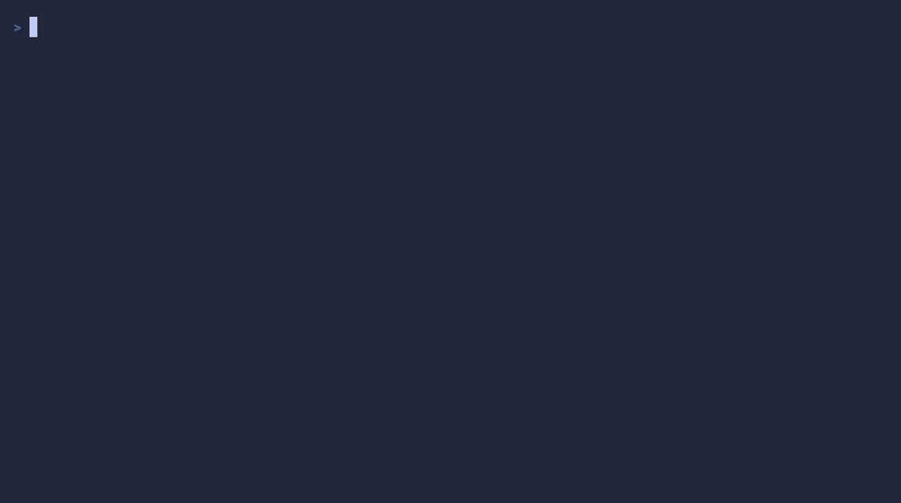

<div align="right"><sub><a href="./README.en.md">English</a> · <b>简体中文</b></sub></div>

<p align="center"><picture><source media="(max-width: 640px) and (prefers-color-scheme: dark)" srcset="./assets/hero-mobile-dark.svg"><source media="(max-width: 640px)" srcset="./assets/hero-mobile-light.svg"><source media="(prefers-color-scheme: dark)" srcset="./assets/hero-dark.svg"></picture></p>

<p align="center">
<a href="https://github.com/SuperMarioYL/deltagate/actions/workflows/ci.yml"></a>

<a href="./LICENSE"></a>
<a href="https://github.com/SuperMarioYL/deltagate/releases"></a>

</p>

<p align="center"></p>

<p align="center"><b>换掉量化包之后，逐条判断哪些抽取结果可以放行。</b><br>
<sub>上一版已人工通过的输出就是参考值 · 按输出类型设字段级 delta 限 · 退出码 3 表示有待复查</sub></p>

<p align="center"><a href="#为什么需要-deltagate">为什么</a> · <a href="#架构">架构</a> · <a href="#安装">安装</a> · <a href="#快速开始">快速开始</a> · <a href="#用法">用法</a> · <a href="#demo">Demo</a> · <a href="#能力与边界">能力边界</a> · <a href="#付费与授权">付费</a> · <a href="#路线图">路线图</a></p>

## 为什么需要 DeltaGate

GGUF 量化包一周一换，内网私有化的 Qwen / DeepSeek 还会悄悄换 serving 栈。同一个抽取 prompt、同一张票据，重跑之后字段值就可能不一样：金额差了 8 毛，日期挪了一天，或者本来是两行明细的地方变成了三行。

这时"这批还能不能放行"通常有三种回答，都不够用：

- **逐字节或模糊 diff**：会同时标出"技术服费"改成"技术服务费"和金额少了 10 元。前者无害，后者要人看一眼——但 diff 给不出哪条该拦。
- **聚合评测**：告诉你这批的均分变化，不告诉你是哪 4 条需要重读。而且生产数据没有标注，均分本身也无从算起。
- **人工重读整批**：最可靠，也最不现实。结果是变更记录常常没读就发了。

缺的是一条**记录级**的放行判据。DeltaGate 把它补上：拿上一版**已人工通过**的输出当参考值（这类数据没有 ground truth，这是唯一可用的参考），按 `output_type` 为每个字段配好 delta 限，逐条给 `RELEASE` 或 `REVIEW`。判定单元永远是记录：任一字段越限，或数组长度、增删字段这类结构发生变化，整条记录进人工队列；否则放行。没有批次总分通路。

限值不是拍脑袋定的。`calibrate` 从历史已通过批次里按**假阳性预算**取分位数：5% 的预算把限值放在 95 分位，意味着一个稳定批次里大约 5% 的记录会被标出来。留出的最后一对快照用来测真实 flag 率，报告里公开这一数字——它测变化量，不测正确性。

这件事与推理栈无关。它不接 ASI 这类本地 agent 栈，也不假设你用哪家模型；GGUF 换版只是最常见的触发器之一。输入就是已经结构化的 JSON，输出是逐条清单和一份可归档的放行记录。

## 它怎么判定

一次 `check` 只做三件事：读两份快照、按规则逐字段比较、把结果写成四件产物。

<p align="center"><picture><source media="(max-width: 640px) and (prefers-color-scheme: dark)" srcset="./assets/process-mobile-dark.svg"><source media="(max-width: 640px)" srcset="./assets/process-mobile-light.svg"><source media="(prefers-color-scheme: dark)" srcset="./assets/process-dark.svg"></picture></p>

| 字段类型 | 比较方式 | 默认限 |
|---|---|---|
| `money` | `abs(Δ) > max(floor, limit × abs(before))` | 0.5%，floor ¥0.01 |
| `numeric` | 同上 | 1% |
| `date` | 整日差 | 0 天（任何日期变化越限） |
| `code` | 归一化后精确相等 | 任何改动越限 |
| `text` | `1 - fuzz.ratio(a, b) / 100` | 编辑距离 0.2 |

数组按下标逐项比较；长度变化本身是一条结构变化，直接 REVIEW。新增或删除字段同理。`text` 的编辑距离是确定性的，不做语义等价判断——这意味着同义改写也会被记为变化，只是幅度可能低于限值。

## 架构

一个 Python 包、四个命令、零常驻服务、零网络调用。`store.py` 是唯一知道目录布局的模块，`rules.py` 是限值的唯一权威；`delta.py` 定义比较语义，`calibrate.py`、`gate.py`、`report.py` 都只消费它。

<p align="center"><picture><source media="(max-width: 640px) and (prefers-color-scheme: dark)" srcset="./assets/architecture-mobile-dark.svg"><source media="(max-width: 640px)" srcset="./assets/architecture-mobile-light.svg"><source media="(prefers-color-scheme: dark)" srcset="./assets/architecture-dark.svg"></picture></p>

| 模块 | 职责 |
|---|---|
| `cli.py` | `init`、`calibrate`、`check`、`accept` 四个命令与退出码 |
| `store.py` | 快照目录布局、记录读取、四件产物的写入 |
| `rules.py` | YAML 规则文件；`limits_version` 是 `v` 加整份文件内容 sha256 的前 12 位 |
| `delta.py` | 归一化、字段类型推断、逐字段差值与越限、结构变化 |
| `calibrate.py` | 用历史快照拟合分位数限，在留出的一对快照上测 flag 率 |
| `gate.py` | 记录级判定汇总、manifest、`review.csv` 校验与幂等 `accept` |
| `report.py` | 单文件 HTML（内联 CSS，无外部 JS）与 review CSV |

`limits_version` 由内容决定，所以改任何一个限值都会换版本号。报告对每条越限同时给出该字段实际使用的数值限值和 `limits_version`；manifest 只记录 `limits_version` 与标定 provenance，不复制整张限值表；`accept` 会拒绝版本不一致的 review 文件。

## 安装

需要 **Python 3.12+**。没有守护进程，没有账号，运行时不需要网络。

```bash
git clone https://github.com/SuperMarioYL/deltagate.git
cd deltagate
uv venv
uv pip install -e .
source .venv/bin/activate
```

也可以直接从仓库装成一个独立的命令：

```bash
pipx install git+https://github.com/SuperMarioYL/deltagate
# 或者
uv tool install git+https://github.com/SuperMarioYL/deltagate
```

发行版会附带 wheel、sdist 与 `checksums.txt`；第一次发布后，可以在 [Releases](https://github.com/SuperMarioYL/deltagate/releases) 下载后本地安装。

## 快速开始

仓库自带一份 24 张票据的合成 fixture：`examples/invoices/accepted/` 是上一版已放行的输出，`examples/invoices/rerun/` 是"换包后重跑"的结果，`examples/invoices/history/` 是三次历史快照，`examples/invoices/rules.yaml` 已按 5% 预算标定过。

```bash
deltagate check \
  --baseline examples/invoices/accepted \
  --candidate examples/invoices/rerun \
  --rules examples/invoices/rules.yaml
```

预期输出（退出码 3）：

```text
DeltaGate · limits v0f168164212b · budget 5.0% · source calibrated (holdout 3.1%)
24 records  →  20 RELEASE   4 REVIEW   flag_rate 16.7% vs budget 5.0%
exit 3  (review required)
  INV-1007  invoice    total_amount   ¥1,284.00 → ¥1,294.20  Δ +0.79%  limit 0.50%  BREACH
  INV-1009  invoice    line_items     length 3 → 2                                STRUCTURAL
  INV-1013  invoice    line_items[1].amount  ¥88.00 → ¥96.80  Δ +10.0%  limit 0.50%  BREACH
  INV-1021  invoice    line_items     length 4 → 3                                STRUCTURAL
out/decisions.jsonl   out/report.html   out/manifest.json
```

24 条里 20 条放行——其中 3 条是 `remark`、`seller`、明细描述的等价改写，编辑距离 4.8%–16.7%，都没到限值。进入队列的 4 条是 2 个金额越限加 2 个数组长度变化。

接下来只有 REVIEW 需要人处理：

```bash
cat out/review.csv
# record_id,output_type,decision,limits_version,reason
# INV-1007,invoice,,v0f168164212b,
# INV-1009,invoice,,v0f168164212b,
# INV-1013,invoice,,v0f168164212b,
# INV-1021,invoice,,v0f168164212b,
```

在 `decision` 列填 `release` 或 `reject`；`reject` 必须写一行理由。然后：

```bash
deltagate accept --manifest out/manifest.json --review out/review.csv \
  --into accepted/ --rules examples/invoices/rules.yaml
# accepted 24 record(s) into accepted/rerun-… · limits v0f168164212b · manifest <12-hex>
```

新快照与 manifest 一起归档，下一次 `calibrate` 就多了一个历史点。同一个批次或同一份 review 文件重复 `accept` 会被拒绝。

从 `git clone` 到第一次 `check` 出结果，按上面的命令走通常在两三分钟内；十分钟是留给"找自己的数据、改三五条限值"的。

## 用法

| 命令 | 作用 | 主要参数 |
|---|---|---|
| `deltagate init` | 扫出 `output_type` 与字段路径，写保守默认限 | `--accepted DIR` `--out rules.yaml` `[--budget]` |
| `deltagate calibrate` | 从历史快照拟合限值，记录 holdout flag 率 | `--history DIR` `--rules FILE` `[--budget]` |
| `deltagate check` | 逐条比对并写出四件产物 | `--baseline DIR` `--candidate DIR` `--rules FILE` `[--out DIR]` |
| `deltagate accept` | 消费 review，归档新快照与 manifest | `--manifest FILE` `--review FILE` `--into DIR` `[--rules FILE]` |

**退出码**

| 码 | 含义 |
|---|---|
| `0` | 全部放行 |
| `2` | 参数、规则文件或状态错误（含重复 accept、版本不一致、review 不完整） |
| `3` | 存在需要复查的记录 |
| `4` | 畸形记录超过候选批次的 2%，先修输入 |

**产物**

| 文件 | 内容 |
|---|---|
| `out/decisions.jsonl` | 每行一条候选记录及其完整判定（字段前后值、delta、limit、是否越限） |
| `out/report.html` | 单文件报告：批次 chip、越限字段表、逐条判定、限值 provenance |
| `out/manifest.json` | `batch_id`、`limits_version`、`budget`、counts、`flag_rate`、`verdicts_sha256`、标定来源 |
| `out/review.csv` | 只含 REVIEW 记录，`decision` 与 `reason` 待填 |

`check` 从目录里读取候选记录，每条记录一个 JSON 文件，并按 `record_id` 排序后逐条判定。畸形记录会被计数并跳过，超过 2% 才以 exit 4 终止。

## Demo

<p align="center"></p>

45 秒录屏，命令与输出逐字取自本仓库的 fixture。要点只有三个：

1. 终端先给出批次结论：`24 records → 20 RELEASE 4 REVIEW`，`flag_rate 16.7%` 对 `budget 5.0%`，`exit 3`。
2. 越限只展开到字段行：`INV-1007 total_amount ¥1,284.00 → ¥1,294.20 Δ +0.79%`，旁边就是 `limit 0.50%`。
3. `out/` 里是同一次运行的四件产物；manifest 的 `calibration` 段写明 `source: calibrated`、`history_snapshots: 3`、`holdout_flag_rate: 0.03125`。

报告是单文件 HTML，内联 CSS、无外部 JS，可以在离线机器上直接打开并归档。fixture 全部是合成数据，不含任何真实公司或税务信息。

## 能力与边界

<p align="center"><picture><source media="(max-width: 640px) and (prefers-color-scheme: dark)" srcset="./assets/capabilities-mobile-dark.svg"><source media="(max-width: 640px)" srcset="./assets/capabilities-mobile-light.svg"><source media="(prefers-color-scheme: dark)" srcset="./assets/capabilities-dark.svg"></picture></p>

| 你手上的问题 | DeltaGate 给的 | 它不给的 |
|---|---|---|
| 换包后这批还能不能放行 | 每条记录的 `RELEASE` / `REVIEW` 与具体越限字段 | 输出内容是否"正确" |
| 放行要留证据 | manifest：限值版本、判定哈希、标定 provenance | 电子签名或不可篡改存储 |
| 人工只处理该处理的 | 只含 REVIEW 的 `review.csv` | 上游重跑调度、自动回滚 |
| 和整批评测并存 | 记录级判据 | 替代聚合均分或显著性检验 |

具体的边界：

- **它测变化量，不测正确性。** 越限记录可能是无害改写；未越限的记录也可能出错。后者由 `calibrate` 的 holdout flag 率暴露，不由报告隐藏。
- **它需要一份已放行的结构化输出。** 如果上一批只留下签字 PDF、没有字段，就没有参考值，这个工具帮不上忙。
- **只吃已结构化的 JSON。** 不做抽取、不调模型、不做 OCR，不支持 PDF、图片、Excel 直接输入。
- **`text` 用确定性编辑距离**，不做 LLM-as-judge 的语义等价判断。
- **数组按下标比较**，元素重排会表现为多个字段变化；嵌套超过两层、跨 `output_type` 的规则继承不在 v0.1 范围内。
- **不做调度与监控。** 没有定时重跑、drift 告警、自动回滚，也不连接数据库或对象存储。
- **不做标注工具与统计显著性检验**；报告只出 JSONL、单文件 HTML 与 review CSV，没有 Excel 版式。

## 配置

规则文件是唯一的限值来源。`init` 会为快照里出现的每个字段写一条，数组元素写成 `line_items[].amount` 这样的模板：

```yaml
limits:
  invoice:
    invoiceNum:
      kind: code
      unit: exact
      limit: 0.0
      normalize: [nfkc, strip_ws, cf_upper]
    total_amount:
      kind: money
      unit: relative
      limit: 0.005
      floor: 0.01
    remark:
      kind: text
      unit: edit_ratio
      limit: 0.2
      normalize: [nfkc, strip_ws]
calibration:
  source: calibrated
  budget: 0.05
  quantile: 0.95
  holdout_flag_rate: 0.03125
```

- `kind` 决定比较方式，`unit` 必须是该类型允许的单位。`money` / `numeric` 可用 `relative` 或 `absolute`；`date` 用 `days`；`code` 用 `exact`；`text` 用 `edit_ratio`。
- `limit` 是主阈值，`floor` 是绝对下限：金额字段设一个 ¥0.01 的 floor，可以避免"一分钱也按比例报"。
- `normalize` 在比较前执行，可选 `nfkc`（全半角与兼容字符）、`strip_ws`（压缩空白）、`cf_upper`（大小写折叠）。
- `calibration` 记录限值从哪来：`source` 是 `defaults` 或 `calibrated`，`budget` 是假阳性预算，`holdout_flag_rate` 是留出集上的实测值。手工改 `limit` 之后这些字段不会自动更新——要么重跑 `calibrate`，要么把 `source` 改回 `defaults` 并说明原因。
- 任何编辑都会改变 `limits_version`。已经写出的 review 文件因此无法被拿去放行另一套限值。

`calibrate` 的规则：至少 3 个快照才有"拟合 + 留出一对"的切分；一个字段至少 5 次观测才拟合；`code` 字段永不拟合；分位数为 0 时不采纳，保留已声明的限值。预算从 5% 改成 30%，限值会收紧，holdout flag 率随之上升——测试里有一条"收紧 3 倍，flag 率大幅上升"的用例固定这个行为。

## 付费与授权

CLI 与自托管是完整的 MIT 开源实现，不设功能闸门，也不需要账号或联网。付费的是"在内网把这件事做完"的交付物，不是命令本身：

- **内网离线包**：零外联交付，装在没有公网的信创环境里。
- **按输出类型维护的规则库**：`invoice` / `ticket` / 公文 的字段类型、单位与限值，随模型和业务变更一起维护。
- **审计归档导出**：把 manifest、`limits_version` 与 review 记录整理成可留存的放行证据。

付费交付在首批验证团队跑通后开放；在此之前只做试跑与 LOI。报价面向每周真的要重跑一次批次的信创交付团队：**¥38,000 / 年 / 内网实例**，含 5 个席位；超出部分 **¥1,200 / 席 / 年**。没有托管版——数据不出内网，我们不提供把记录上传到云端的形态。

起步方式是一次 30 分钟离线试跑：在你自己的机器上跑 `check --baseline accepted/ --candidate rerun/`，如果评审人认可 ≥70% 的 flag 是真实变更，就签 60 天 ¥0 试点，转化价格写进试点协议；试点结束开票，以 v0.2 的交付内容为准。付款支持对公转账 / 微信支付，可开增值税专用发票。

一句实话：LOI 不是收入，v0.1 也没有付费墙。如果上面的场景对你们不成立——比如你们并不保留上一版的结构化输出——那这个工具就是没用的，直接说就好。

## 路线图

已经实现：

- [x] `init` 推断字段类型与保守默认限。
- [x] `check` 逐字段比对，数组长度变化与增删字段判 REVIEW，退出码 0/3。
- [x] `calibrate` 用历史快照取分位数限，留出集测 flag 率；历史不足时明确落 `defaults`。
- [x] `accept` 消费 review，新快照与 manifest 一起归档，重复 accept 被拒。
- [x] 单文件 HTML 报告，含批次 chip、越限字段表与标定 provenance。
- [x] 24 条票据 fixture、45 秒录屏、中英双语文档。

接下来是探索方向，不是当前版本的能力承诺：

- [ ] v0.2 的内网离线包与多输出类型规则库维护流程。
- [ ] 审计归档导出：manifest、review 与限值版本的可留存包。
- [ ] 更细的结构变化：区分数组重排与真正的内容增删。
- [ ] reviewer 队列的补充格式（目前只有 CSV）。

带着真实批次来[提 Issue](https://github.com/SuperMarioYL/deltagate/issues) 最有帮助：字段类型、你实际用的限值、以及哪些变化被人判为无害，这些会直接影响下一步。

## 开发

```bash
python -m pip install -e '.[dev]'
python -m pytest -q
vhs assets/demo.tape   # 重新录制 assets/demo.gif，需要 vhs、ttyd、ffmpeg
```

测试覆盖字段类型的比较语义、结构变化、记录级判定与退出码，以及标定的分位数、留出集 flag 率、预算收紧与 `limits_version` 的一致性。测试不依赖终端颜色或网络，在 CI 上应稳定通过。

MIT 许可。动画图组与网站共用同一套配色；减少动效模式下，图中的模块关系与示例结果仍然完整。

<p align="center"><sub><a href="./LICENSE">MIT</a> © 2026 SuperMarioYL</sub></p>
